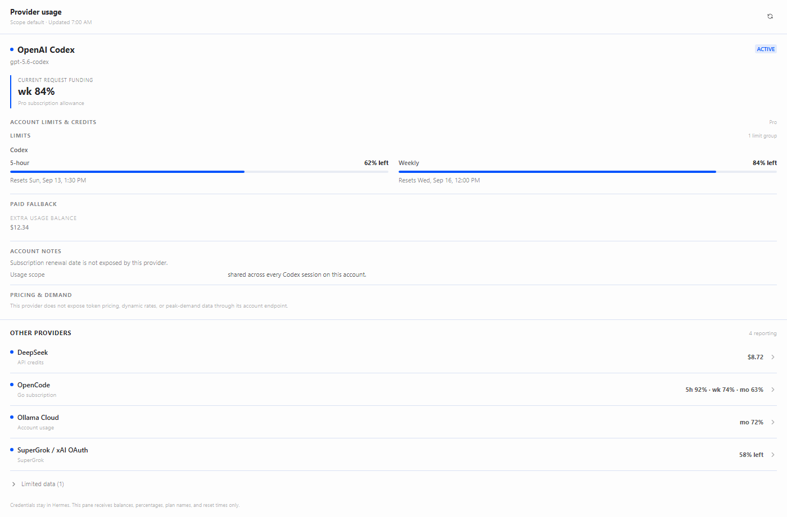
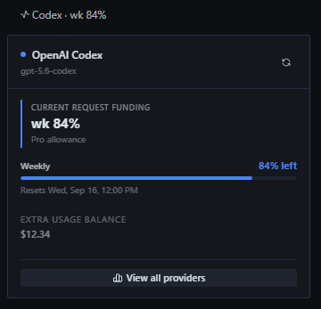

# Hermes Provider Usage

Your agent is only as useful as the account limit it can still spend. Provider Usage puts that limit beside the model you are already using in Hermes Desktop: a compact status-bar chip, a detail popover, and a full page for every provider and window.

**Click the chip** to see the active provider's governing windows, reset times, fallback balance, and account state. **View all providers** opens the full page, also reachable from the sidebar and the ⌘K palette.

The plugin reports the **shared account resource** behind a provider. It does not divide a Codex, Claude, or OpenCode allowance between chats. Five sessions on one account all draw from the same pool.

## Look at it

These images are **sample data rendered in a browser component harness** from the plugin's real components and SDK primitives with the built-in Nous dark theme. They are **not screenshots of the packaged Electron app**, and no real account values appear. See `harness/` for the reproducible capture.





More: the [12-shot gallery](assets/hackathon/gallery.html), [feature and trust-boundary infographic](assets/hackathon/infographic.png), [full demo](assets/hackathon/demo-full.mp4), and the [hackathon guide](docs/hackathon-guide.md) with the shot list, evidence tiers, and build notes.

## What it does

- Adds a small active-provider meter to the Desktop status bar.
- Shows every governing subscription window, not just the one that fits in the chip.
- Keeps subscription allowances primary and paid fallback balances secondary.
- Refreshes against the focused profile and session when you switch bots or profiles.
- Keeps API keys and OAuth credentials in the Python backend.
- Marks missing data **Unavailable** or **Unknown** instead of filling gaps with guesses.
- Adds a running-agents footer to the popover when the gateway reports live delegated children.

A Spark session is the useful example: Spark can have separate 5-hour and weekly limits. The chip shows the resource that can fund the next request, while the page keeps both meters and their reset times visible. An exhausted weekly limit does not make the still-full 5-hour meter disappear.

### Don't see the chip?

The chip lives in the Desktop **status bar** at the bottom of the window, and that bar can be hidden as a per-machine preference. When it is hidden, every status readout disappears with it.

- **Ctrl+Shift+S** (⌘+Shift+S on macOS) toggles the status bar.
- Or right-click the app → **View → Toggle status bar**.
- Or open the command palette and search **Toggle status bar**.

If the bar is visible but the chip is not, check **Settings → Plugins** and confirm the backend is enabled for this profile (see [Install](#install)).

## Provider support

| Provider | What you get | Evidence |
| --- | --- | --- |
| OpenAI Codex | Shared subscription windows, Spark windows, resets, access state, subdued extra-usage balance, and banked-reset inventory when the host returns it | Stock compatibility tests |
| OpenCode Go | 5-hour and weekly usage in the chip; all three subscription windows in the page | Stock compatibility tests |
| OpenCode Zen | Authenticated API-credit product state; wallet balance stays unavailable because OpenCode does not expose it to API keys | Limited by the provider |
| DeepSeek | API balance in the currency DeepSeek returns | Stock compatibility tests |
| OpenRouter | Remaining API credit, key quota, and spend detail | Stock compatibility tests |
| Ollama Cloud | Session, weekly, and monthly windows plus per-model request counts | Experimental endpoint; plans differ |
| Nous Portal | Portal credit snapshot when the installed Hermes runtime exposes it | Host-dependent |
| Claude / Anthropic | Always-listed card. Claude subscription limits through the existing Claude Code OAuth read; Anthropic API Admin usage is a separate organization product and is not metered here | Subscription read uses the existing core adapter; card is fixture-tested, **not live-verified in this release** |
| Google Gemini API | Always-listed **setup and capability card**: API-key setup and documented per-project rate limits. No supported account balance/quota endpoint, so usage stays in Google AI Studio | **Setup only; no account adapter and no live account test** |
| Z.ai / GLM | Always-listed **setup and capability card**: GLM Coding Plan quota versus standard pay-as-you-go billing, with global and China endpoints. Hermes has no `zai` account-usage hook, so no quota or credit is invented | **Setup only; no account adapter and no live account test** |
| xAI / Grok | On stock Hermes 0.23.1 there is no xAI broker, so the row is unavailable with the official Grok dashboard link. Subscription credits appear only when the host brokers `xai-oauth` | Stock: link only; broker is optional |
| Declarative JSON | Any fixed read-only HTTPS usage or balance endpoint you describe with the bundled schema; GitHub rate limits ship ready to use | Tested boundary and GitHub live check |

OpenCode is one family in the UI, but its products stay separate. **Go is subscription-funded. Zen is API-credit-funded.** They use different routes and credentials, and the plugin never treats one as the other's balance.

The **Claude / Anthropic**, **Google Gemini API**, and **Z.ai / GLM** cards are always listed, including with no credentials. They are connection and capability cards, not meters: an unconnected card says **Not connected**, and none of them invents a zero balance, remaining quota, or local spend total. Gemini and Z.ai have no account-usage read in this build; their numbers stay in the provider's own console.

The Grok billing response exposes quota data but no trustworthy plan-tier name, so the plugin uses the conservative label **SuperGrok** and does not infer a higher tier.

See [PROVIDER_SUPPORT.md](PROVIDER_SUPPORT.md) for tested capabilities, selection rules, and the exact stock/enhanced split in [docs/stock-support.md](docs/stock-support.md).

## Reset credits, carefully

On a Codex row where the host exposes banked resets, **Banked reset credits** shows a read-only summary for the active signed-in account. **Preview reset** opens a separate confirmation block naming that account and the banked/applicable counts. Only the confirm button mutates, and it spends one subscription reset, never a paid API credit.

- There is no exact-credit selection: core picks the credit, and the API accepts **no credit selector, force flag, caller URL, or purchase flag**. There is no purchase action anywhere.
- Success is reported only after an independent same-identity readback shows a lower banked count. A missing, unchanged, or mismatched readback is **uncertain**, not success, and is never retried automatically.
- Core redemption is account-implicit, so the active-account binding is a **point-in-time re-check, not an atomic reservation**. With multiple pooled Codex credentials, a credential switch between preview and redeem cannot be excluded; the panel stays limited to the account Hermes currently resolves rather than offering a multi-account selector.

No reset is redeemed by the tests, the harness, or the screenshots. The design record is [docs/reset-capabilities.md](docs/reset-capabilities.md).

## Running agents

When the popover is open and the gateway reports live delegated children, a subordinate footer lists them and, where an exact account identity is published, the shared pool they draw from. On stock 0.23.1 the provider/account identity inventory is often absent, so the footer shows an unknown account (or no footer) instead of borrowing another account's figure. It never divides usage per agent or invents a per-agent cost. Details: [docs/running-agents-footer.md](docs/running-agents-footer.md).

## Bring your own read-only usage API

Provider Usage 0.10 supports **declarative definitions**: versioned JSON that describes a fixed read-only HTTPS endpoint and maps its JSON into provider cards. It is data only — no scripts, `eval`, templates, arbitrary headers, or literal credentials.

Three definitions ship in the catalog:

- **GitHub API rate limit** — credential-free; core, search, and GraphQL request windows for this machine or the configured token.
- **Moonshot / Kimi balance** — prepaid balance; references `MOONSHOT_API_KEY`.
- **ElevenLabs subscription** — character allowance and reset; references `ELEVENLABS_API_KEY`.

The page distinguishes **Connected**, **Available to connect** (with the missing variable), **Requires approval**, **Blocked**, and **Invalid definition** states. Missing mapped values stay **Unavailable**, never zero.

To add one, start from `dashboard/definitions/TEMPLATE.json`, then:

```bash
python scripts/validate_definition.py ~/.hermes/provider-usage/providers/my-api.json
python scripts/approve_definition.py ~/.hermes/provider-usage/providers/my-api.json
```

Approval names the destination and every credential reference, reads no secret, and requires you to type `approve`. It writes `$HERMES_HOME/provider-usage/approvals.json`, outside the definitions directory. Editing the file changes its fingerprint and revokes approval until you review it again. Nothing in a definition or the packager can approve itself.

The boundary is HTTPS GET only, exact host allow-list, no redirects, a pinned public peer, and a bounded response. Credential *references* resolve only through Hermes' profile-scoped `agent.secret_scope.get_secret`; there is no `os.environ` fallback. See [dashboard/definitions/README.md](dashboard/definitions/README.md) for the schema and trust model.

Approval is a **local consent boundary, not a sandbox**. Code running as the same OS user can edit both the definition and the approval record, and can read profile credentials directly. It prevents an unreviewed definition from using a profile secret without a human seeing the destination first; it does not defend against malicious same-user code or a compromised Hermes process.

## Install

Requirements: **stock Hermes Desktop 0.23.1 or newer**, a local Hermes gateway, and a current Desktop build. No core patch, private worktree, or unmerged core commit is required.

```bash
hermes plugins install jerrygooch/hermes-provider-usage
```

The unified package ships both halves: the Desktop UI and the profile backend. Hermes installs it under the profile and Desktop loads the Desktop half. The installer confirms before enabling. Add `--enable` to skip that prompt, or enable later:

```bash
hermes plugins enable provider-usage
```

For a reproducible install, pass an exact 40-character commit:

```bash
hermes plugins install jerrygooch/hermes-provider-usage --ref <40-character-commit-sha>
```

Recycle that profile's gateway after install. Do **not** copy files into Hermes core, apply a core patch, or hand-edit the profile plugin folder.

**Per profile.** The Python backend loads only in the profile where `provider-usage` is enabled. Run the install once for each profile that should expose usage; installing in one profile does not enable or modify another. The plugin never auto-enables or auto-installs into a profile. A profile without the backend returns `/overview` 404, and both the page and chip say **"Provider usage isn't enabled or installed in &lt;profile&gt;."**

Optional host helpers — exact account identity inventory, provider credential summary, banked-reset details, or the xAI broker — are detected at runtime. Their absence changes one row or one value to **Unavailable**; it does not disable the plugin.

## Profile scoping and focus divergence

`ctx.rest` reaches the **active** socket's profile and connection, never the focused chat's. The plugin treats a focused session as readable only when its connection-qualified owner matches that active source. When a focused chat belongs to another profile or connection, or the SDK reports the focus as ambiguous, the surfaces fail closed with **"The focused chat is in … — switch to view its usage"** and issue no fetch or probe for a foreign account. Home-account rows are never shown under another account's focus. On return to a matching profile, cached rows come back.

## Development

The shipped `desktop/plugin.js` is plain ESM with no runtime npm dependencies. The development harness adds `jsdom`, `react`, and `react-dom`; the browser harness bundles the plugin with the Hermes desktop SDK source for a faithful component render.

```bash
npm ci
npm run check          # syntax, Node suites, Python suites, definitions, py_compile
bash scripts/validate.sh
```

The browser evidence is separate and uses real Chromium/Edge with real SDK primitives:

```bash
node harness/build.mjs && node harness/capture.mjs && node harness/verify.mjs
node harness/popover-verify.mjs
```

The live GitHub rate-limit definition can be checked without credentials:

```bash
python scripts/live-check-github.py
```

The fixture suite covers shared Codex limits, Spark windows, Plus 5-hour usage, DeepSeek balances, OpenCode Go/Zen funding semantics, SuperGrok's conservative label, paid fallback after exhaustion, and declarative catalog states. The Node and Python suites are automated tests, not live-account proof: the Claude, Gemini, and Z.ai cards were not exercised against real accounts in this release.

## Status and limits

Provider Usage 0.10 is an experimental plugin. Provider account APIs change without notice, especially OAuth and web-app endpoints; experimental adapters are labelled in the support table rather than presented as permanent integrations. Stable documented APIs are preferred, and missing data stays missing.

The plugin is read-only for usage. The only mutation is the separately gated Codex banked-reset action described above; it cannot buy credits, enable paid usage, change a plan, or purchase a reset. The Desktop renderer never receives API keys, OAuth tokens, authorization headers, or raw credential objects; provider requests run in the backend.

No security review can promise more than its boundary. This one is a reviewed local consent and credential-isolation design with documented residual risks, not an unlimited guarantee.

## Help wanted

- Adapters for more providers, backed by a real account-level usage or balance source.
- Testing across plans and account types without sharing private data.
- Hermes-native UI work, accessibility fixes, and visual polish.
- Fixtures for model-specific limits and unusual reset behavior.
- Documentation of provider quirks and honest unavailable states.

Read [CONTRIBUTING.md](CONTRIBUTING.md) before opening a pull request. Never attach API keys, OAuth tokens, raw provider responses, account screenshots, or request logs to an issue.

## License

[MIT](LICENSE)
