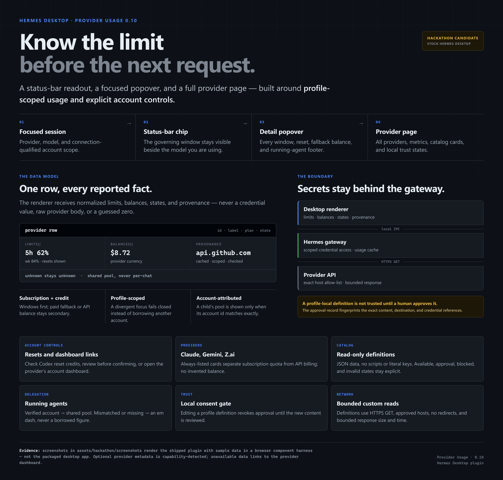

# Provider Usage — hackathon guide



*Diagram only. The screenshots in this package are separate, and every value in them is synthetic sample data.*

## What it is

Provider Usage puts the account limit that governs the next request beside the model you are already using in Hermes Desktop. It adds three surfaces:

1. a compact **status-bar chip**;
2. a **popover** with the current provider's windows, resets, fallback balance, and running-agent footer;
3. a **full Provider Usage page** with every reported provider, credit balance, metric panel, catalog card, and definition state.

The plugin reports the **shared account resource** behind a provider. It does not divide a Codex, Claude, or OpenCode allowance between chats. Five sessions on one account all draw from the same pool.

## Compatibility and stock install

Provider Usage 0.10 runs on **stock Hermes Desktop**, with a manifest floor of **Hermes 0.23.1**. It does not require an unmerged core patch or a private worktree. The route-by-route stock matrix is in [docs/stock-support.md](stock-support.md).

Some provider rows expose optional metadata — exact account identity, banked-reset inventory, or delegated-owner attribution — only when the installed host reports that capability. The plugin detects this at runtime. When a capability is absent, the row stays explicit: supported windows remain visible, the optional value says **Unavailable** or **Unknown**, and the card links to the provider's own account or usage page. It never synthesizes a count, balance, or reset, and it has no raw runtime-key, credential-store, or private-auth fallback.

The UI package in this directory is verified as a **browser component harness** against `desktop/plugin.js` with the current reset panel, using the real SDK primitives. It is not a capture of the packaged Electron app, and it is not evidence of live provider calls. These are **pre-freeze captures**; the release owner may regenerate them against the frozen stock build. See [Screenshot evidence](#screenshot-evidence).

## Install (stock build)

Requirements:

- a **stock Hermes Desktop** on Hermes 0.23.1 or newer (no patched or unmerged core build);
- a local Hermes gateway;
- Node 20+ only for the development harness (the shipped plugin has no runtime npm dependencies);
- Python 3 for the local definition validator, approval CLI, and backend.

Optional host capabilities do not change the install: they are detected after the backend starts. If a row says **Unavailable** or offers a provider dashboard link, that is the capability gap being reported, not an installation failure.

Install the unified package from its repository:

```bash
hermes plugins install jerrygooch/hermes-provider-usage
```

The unified package ships both the Desktop half and the profile backend; Hermes installs it under the profile and Desktop loads the Desktop half. The installer confirms before enabling. Use `--enable` to skip that prompt, or run `hermes plugins enable jg-provider-usage` later. For a reproducible install, add `--ref <40-character-commit-sha>`.

The backend is **per profile**. Run the install once for each profile that should expose usage; it does not enable or modify another profile. Recycle that profile's gateway after install. In Desktop, enable **Provider Usage** under **Settings → Plugins** if it is opt-in. A profile without the backend returns `/overview` 404 and both the page and chip say that the plugin is not enabled or installed in that profile. Hermes never auto-edits or auto-installs a profile, and no core patch or manual core edit is needed.

If the bar is visible but the chip is not, the status bar itself may be hidden. Use **Ctrl+Shift+S** (⌘+Shift+S on macOS), **right-click → View → Toggle status bar**, or the command palette's **Toggle status bar**. The chip lives in that shared strip, so every status readout disappears with it, not just this plugin.

## Use

- **Read the chip.** It shows the active provider and the governing resource for the focused model. Click it to open the popover.
- **Read the popover.** It keeps every governing window visible — for example a 5-hour and weekly window — with reset times. A paid fallback balance is shown only when the subscription path is exhausted, or when the provider is credit-funded.
- **Open the full page.** Choose **View all providers** in the popover, the sidebar's **Provider Usage** row, or the **⌘K** palette entry. The page shows the active provider's full metric set, other reporting providers, always-listed popular-provider cards, and the declarative catalog.
- **Expand another provider.** Provider rows expand in place to show their own windows, balances, activity, rates, cache, and definition provenance when the adapter supplies those fields.
- **Read the running-agent footer.** A delegated child is attributed to a shared pool only when the backend publishes both its provider and an account id that matches exactly one known inventory account. A mismatch shows **—**, never another account's figure.
- **Banked resets, when the host exposes them.** On a Codex row, **Banked reset credits** first shows a read-only summary for the active signed-in account. **Preview reset** opens a separate confirmation block naming the account and the banked/applicable counts. The confirm button is the only mutation; it spends one subscription reset and never a paid API credit. There is no exact-credit selection: core picks the credit, and the API accepts no credit selector, force flag, caller URL, or purchase action. Success is reported only after an independent same-identity readback shows a lower count; a missing or mismatched readback is **uncertain**, not success. The active-account binding is a point-in-time re-check, not an atomic reservation, so a pooled credential switch between preview and redeem cannot be excluded. The captures stop at the preview; no reset was redeemed.

Unknown data stays unknown. The plugin does not turn a missing percentage into `0%`, a missing balance into `$0.00`, or an unresolved currency into USD.

## Provider coverage and limits

The route-by-route tables are in [PROVIDER_SUPPORT.md](../PROVIDER_SUPPORT.md), [docs/stock-support.md](stock-support.md), and [README.md](../README.md). In short:

| Provider or route | What the plugin can show | Limit / status |
| --- | --- | --- |
| OpenAI Codex | Shared subscription windows, reset times, extra-usage fallback | Tested; Spark has its own windows. Banked resets and exact account labels appear only when the stock host exposes them; otherwise the card links to the Codex account page |
| OpenCode Go | 5-hour, weekly, and monthly subscription usage | Tested; chip keeps the blocking meters visible |
| OpenCode Zen | Authenticated API-credit product state | Wallet balance is not exposed to API keys, so it says unavailable |
| DeepSeek | API balance in the provider's currency | Tested |
| OpenRouter | Remaining API credit | Tested |
| SuperGrok / xAI OAuth | Official Grok account link; subscription credits only on a host that brokers xAI sign-in | Stock has no xAI broker, so the row is unavailable with the official dashboard link. No raw token read |
| Ollama Cloud | Reported session/weekly/monthly windows and per-model counts | Experimental endpoint; plans differ |
| Nous Portal | Portal credit snapshot when the runtime exposes it | Experimental; host-dependent |
| Declarative JSON | Any fixed read-only HTTPS usage or balance endpoint described by schema v1 | Tested; profile-local files need local approval |
| Claude / Anthropic | Always-listed card; Claude subscription windows through the existing Claude Code OAuth read | Card/fixture-tested. API Admin usage is a separate product and is **not** read here; if the subscription snapshot is unavailable, the card links to Claude Settings → Usage |
| Google Gemini API | Always-listed card with API-key setup and per-project rate-limit facts | No supported account balance/quota endpoint; the card links to AI Studio → Usage and Billing. **Not live-verified** |
| Z.ai / GLM | Always-listed card separating GLM Coding Plan quota from standard API billing and endpoints | No account-usage hook; the card links to the Z.ai console. No quota or credit is invented. **Not live-verified** |

Not supported by design: OAuth refresh, writes, purchases, gRPC, HTML scraping, multi-step requests, or arbitrary header values in a definition. Complex protocols need a reviewed Python adapter. **Tested** above means automated stock-compatibility or fixture tests, not a live private-account call; the Claude, Gemini, and Z.ai cards were not live-tested for this package.

### When a stock host does not expose a value

Optional fields can be missing on an older stock build even though the provider is configured. The card keeps the supported rows and sends you to the provider's own dashboard for the rest:

- **Codex / OpenAI** — the account usage page for banked resets and plan state;
- **Claude / Anthropic** — **Settings → Usage** for subscription resets; Anthropic API usage stays in the organization Admin console;
- **Google Gemini API** — **AI Studio → Usage** for request usage and **Billing** for prepay balance;
- **Z.ai / GLM** — the Z.ai console for Coding Plan quota or standard API balance, depending on the key;
- **xAI / Grok** — the official Grok dashboard; stock has no xAI usage broker, so no subscription credit is inferred.

These are ordinary links opened by the user. The plugin does not scrape the page, reuse a browser session, or turn a missing value into a number.

## Always-listed provider cards (agent-contributed)

The Claude / Anthropic, Google Gemini API, and Z.ai / GLM cards were added during the hackathon and reviewed into this source snapshot. They are **code-owned connection and capability cards**, not declarative JSON definitions and not usage adapters:

- **Claude / Anthropic** — separates the supported Claude subscription read (Claude Code OAuth snapshot) from Anthropic API Admin usage, which requires an organization Admin API key and the admin role and is not metered by this plugin.
- **Google Gemini API** — states API-key setup and per-project rate limits. Google publishes usage and prepay balance in AI Studio/Billing; this plugin has no supported balance endpoint and does not infer quota from rate-limit caps.
- **Z.ai / GLM** — explains GLM Coding Plan quota versus standard pay-as-you-go billing, and the global (`api.z.ai`) and China (`open.bigmodel.cn`) endpoints. Hermes has no `zai` account-usage hook here, so the card shows setup and capability limits only.

They are always listed, including with no credentials. On stock 0.23.1 the presence check falls back to the profile secret scope; an OAuth-only card that cannot be proven says **Unverified**, not **Not connected**. Newer hosts can add the non-secret credential summary. A missing credential never becomes a zero balance or a fabricated meter. Their fixtures live at `harness/fixtures/popular-connections.json`; their renderer coverage is in `tests/test_connection_cards.py` and the Node render suite. None of the three was live-verified for this package.

## Declarative definitions and contribution

A definition is data-only JSON for a fixed read-only HTTPS GET. It has no scripts, expressions, `eval`, templates, or literal credentials. Start from [dashboard/definitions/TEMPLATE.json](../dashboard/definitions/TEMPLATE.json) and read [dashboard/definitions/README.md](../dashboard/definitions/README.md).

```bash
# validate: no network call, no approval
python scripts/validate_definition.py ~/.hermes/provider-usage/providers/my-api.json

# approve the exact content locally; this reads no secret and asks you to type "approve"
python scripts/approve_definition.py ~/.hermes/provider-usage/providers/my-api.json

# package a sanitized contribution; this never publishes and never creates approval
python scripts/package-definition.py ~/.hermes/provider-usage/providers/my-api.json
```

Profile-local definitions stay **Approval required** until the exact content is approved. Editing the file changes its fingerprint and moves it to **Blocked** until reviewed again. The approval record lives outside the definitions directory and contains the content digest, endpoint, and structured credential references. Copying a definition or using `Copy setup steps` is not approval.

To contribute:

1. Add the bundled definition under `dashboard/definitions/catalog/`, or a new adapter with fixtures and tests under `dashboard/` and `tests/`.
2. Run `npm run check` and the relevant Python suites against the frozen stock build you intend to support.
3. Prepare a sanitized package locally; do not include approval manifests, credentials, raw responses, account screenshots, or machine paths.
4. Open a pull request manually. Review is the publication gate; no script in this repository pushes or publishes.

The three popular-provider cards are code-owned metadata in `dashboard/plugin_api.py` (`_CONNECTION_CARDS`) plus `ConnectionCardsSection` in `desktop/plugin.js`, with fixture and renderer tests. Adding another card is a source change, not a catalog JSON drop.

## Security model

- **Credential boundary.** Keys and OAuth tokens stay in the Hermes backend. The renderer receives normalized labels, numbers, states, plan names, and provenance — never a key, token, raw provider body, or authorization header.
- **Read-only requests.** Declarative definitions allow HTTPS GET only, on the default port, with an exact host allow-list, no query-string credentials, no redirects, a 512 KiB response cap, a 10 s per-read timeout, and a 20 s wall-clock budget. DNS is resolved once; the connection is pinned to a vetted public peer while TLS SNI and `Host` remain the definition hostname. Proxy and `.netrc` discovery are disabled.
- **Local trust gate.** Bundled definitions are code-owned. Every profile-local definition is denied until a human approves its exact digest, endpoint, and credential references. The page never grants trust and never fetches data for an unapproved file.
- **Profile scoping.** The focused chat's connection-qualified owner selects the account. When the focus is on another connection, ambiguous, or present-but-null, the surfaces fail closed instead of showing this machine's account rows under another account's name.
- **Capability detection.** Optional host features are additive. A missing identity, reset, or delegation capability produces an explicit unavailable state and a provider dashboard link; it does not disable the base usage reads or trigger a fallback credential path.
- **Reset gate.** Banked reset is a separate account mutation, not a refresh. It reads the active signed-in Codex account from the stock snapshot identity, has no pool selector, and requires an explicit preview followed by a confirmation token. The confirm action is never exercised by the screenshot harness.
- **Read-only usage path.** The provider-usage reads cannot buy credits, enable paid usage, change a plan, or write provider state. A separate banked-reset action, if present in a stock build, is preview/confirm-gated and does not purchase anything.

Honest limits: approval is a **local-user consent boundary, not a sandbox**. Code running as the same OS user can edit the definition and the approval record, and can read the profile's credentials directly. DNS rebinding between the preflight check and the HTTP client's connection remains a documented residual risk; the pinned-peer design narrows it but does not eliminate every network-layer attack. The cache is in-process and disappears on gateway restart.

## Screenshot evidence

The public gallery is [assets/hackathon/gallery.html](../assets/hackathon/gallery.html); the machine-readable inventory is [assets/hackathon/manifest.json](../assets/hackathon/manifest.json). Twelve screenshots cover:

- `01-status-chip` — the toolbar trigger;
- `02-popover-current` — current-provider detail;
- `03-popover-running-agents` — verified shared pool and unknown-account rows in one footer;
- `04-overview-multi-provider` — subscription and credit providers on the full page;
- `05-overview-expanded-metrics` — activity, cache, rates, and pool breakdown;
- `06-popular-connections` — the complete Claude / Gemini / Z.ai section (all three cards, not a text-only assertion);
- `07-catalog-available` — Moonshot and ElevenLabs available-to-connect cards;
- `08-catalog-trust` — approval required, blocked, unknown, and unverified states;
- `09-catalog-invalid` — exact schema errors;
- `10-narrow-420` — the plugin's own narrow layout;
- `11-reset-summary` — the stock-native Codex banked-reset summary, read-only and active-account bound;
- `12-reset-confirm` — the preview/confirm block. The fixture stops here; the confirm button was never clicked and no reset was redeemed.

A short clip, [assets/hackathon/demo.mp4](../assets/hackathon/demo.mp4), records the real pointer move and chip click in the component harness and the popover opening. It is 5.9 seconds, 1280×720, silent, and carries a permanent **Component harness · sample data · not the packaged desktop** label. It is a teaser, not the 88-second demo script.

**Evidence tier:** these are real component-harness renders of the plugin from the pre-freeze visual capture, with real SDK widgets and the built-in `nous` dark theme, using synthetic fixtures. They are **not** packaged-desktop screenshots and not live provider responses. The chip → popover interaction is exercised in Chromium; the page states are rendered and text-asserted. The popular section is measured, not text-matched: three distinct 724 px cards sit inside the 760 px section without overlap, and the Z.ai card is fully inside the captured bounds. Some optional rows in these pre-freeze stills (for example xAI subscription data) are sample states that appear only on a host exposing the optional helper; stock 0.23.1 shows the official dashboard link instead. Every PNG is metadata-stripped and hashed in the manifest. The gallery is verified at an 830 px body width (all images loaded, no horizontal overflow); the infographic is also checked at 830 px for legibility. The release owner may refresh these images against the frozen build.

## Verification

Reproduce the visual package:

```bash
node harness/build.mjs
node harness/hackathon-capture.mjs
node harness/hackathon-render.mjs
python harness/hackathon-finalize.py
```

The capture script asserts the chip's positive geometry inside its 230 px production cap, the 356 px popover, the current-provider windows, the running-agent footer text, the popular-card section with all three cards, catalog states, and the absence of inner scroll clipping. It does not assert a live gateway.

At the pre-freeze capture point, the stock compatibility suite passed. The current
release-focused suite passes **56 focused tests with 0 failures** (parent verification at
`fd895ea`); the full repository gate is `npm run check`. The Node
logic/render/lifecycle/running-agent suites, the connection-card tests, and the packaged
definition validation are part of that gate. Re-run it against the frozen stock build
before publishing; the visual harness does not open a live gateway.

## Known limitations

- **Stock builds vary.** Optional identity, reset, and delegated-owner metadata appears only when the installed host exposes it. Missing values stay **Unavailable** and link to the provider dashboard; they are not guessed. This is capability detection, not an unmerged-patch requirement.
- The three popular-provider cards are fixture-tested, not live-tested. Gemini and Z.ai have no account-usage read in this build.
- Anthropic API Admin usage is not read; only the existing Claude Code OAuth subscription snapshot is supported.
- The packaged Electron app was not launched for these images. The component harness is the evidence tier; the release owner may refresh the images against the frozen build.
- **Screenshot snapshot:** pre-freeze visual capture, with the read-only reset summary and confirmation preview rendered from fixture data. The current code is `fd895ea`; captures 11–12 stop at the preview, the confirm button was never clicked, and no reset was redeemed. The release owner may refresh the images against the frozen build.
- A profile's backend is separate; a missing backend is shown explicitly and never auto-installed.
- Provider APIs change. Experimental adapters (SuperGrok, Ollama Cloud, Nous Portal) can regress without notice.
- The definition cache is in-process; a restart starts cold.
- No publishing, upload, or source commit is performed by this documentation package. The parent submission process owns final assembly and publication.
